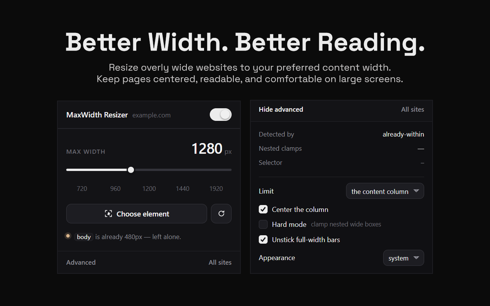

# MaxWidth Resizer



A Chrome extension that stops websites from stretching their content across your
whole screen.

On a big monitor, a lot of sites have no width limit. Paragraphs run from the far
left edge to the far right edge, 200 characters per line, and reading them is
tiring. MaxWidth Resizer finds the main content on the page, caps it at a width
you choose, and centers it. Everything else about the page stays the same.

## What makes it different

Most width limiters just slap a `max-width` on `body` and hope for the best.
That breaks pages with sidebars, sticky headers, and full-width images.

This one looks at the page first. It measures how much actual text each element
holds, ignores the parts that are mostly links (nav bars, sidebars, footers), and
picks the box that really is the content. Then it checks that capping that box
won't swallow a neighbouring column.

If it guesses wrong, you can click the element yourself and it remembers that
choice for the site.

## It starts switched off

The extension does nothing at all until you turn it on for a site. On a page you
haven't enabled:

- no styles are injected
- nothing on the page is touched
- nothing is written to storage

Turn a site off again and its rule is removed. Your custom width and any picked
element are kept, so you don't lose your setup if you switch it back on later.

## Features

**Smart detection.** Finds the content column by text density, not by guessing at
class names. Works on sites with no semantic markup at all.

**Adjustable width.** A slider in the popup, remembered per site.

**Two ways to limit.** Cap just the content column and leave the nav and sidebar
alone, or cap the whole page so the entire layout becomes one centered column.

**Pick it yourself.** Press "Choose element" and click the exact box you want.
Useful for web apps that the detector can't figure out. Remembered per site.

**Hard mode.** For dashboards with fixed-width panels inside the content area.
Clamps the boxes that are still too wide so nothing spills off the page.

**Light and dark.** Follows your system theme, or you can pin it.

**Keyboard shortcuts.** `Alt+Shift+W` toggles the current site. `Alt+Shift+P`
starts the element picker. Both are also in the right-click menu.

## Install

Get it from the Chrome Web Store:

*(link here once it's live)*

## How it decides

```
Off by default      nothing happens until you enable a site
Window is small     nothing happens, the page already fits
Site limits itself  nothing happens, it never widens a page
Otherwise           cap the content column and center it
```

Some rules it follows, so you know what to expect:

- It only ever narrows. It will not stretch a page that already limits itself.
- If the site's own limit is tighter than yours, the site's limit wins.
- It never widens anything to fill space. If the content column's natural width
  is already under your cap (because the layout leaves it little room), nothing
  is applied and the popup tells you so.
- Hard mode skips full-bleed media like heroes, maps, carousels and videos.
- Only the top page is handled. Iframes are left alone.

## Good to know

Detection is a heuristic, so it won't be perfect on every site. Heavy web apps
with multiple panes (email clients, canvas editors) usually need one manual pick
per site, and then they're fine forever.

If a page looks worse after enabling it, press `Alt+Shift+W` to turn it off
again.

## Privacy

It collects nothing. No analytics, no tracking, no network requests at all. Your
settings live in Chrome's own extension storage on your computer. See
[PRIVACY.md](PRIVACY.md).

## Permissions, and why

| Permission | Reason |
|---|---|
| `storage` | Saves which sites you enabled and the width you chose |
| `scripting` | Adds the extension to tabs that were already open when you installed it, so you don't have to reload first |
| `contextMenus` | The two right-click menu items |
| `http://*/*`, `https://*/*` | It has to be able to run on whichever site you turn it on for. It does nothing on sites you haven't enabled |

## License

MIT
